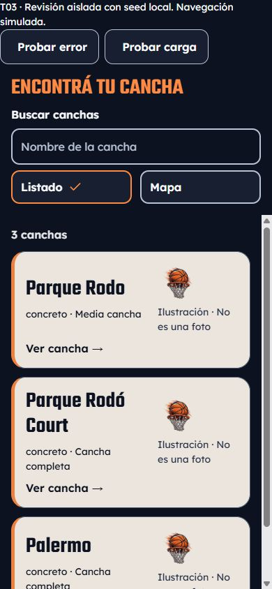

# T03 implementation and local verification — 2026-10-14

Current presentation has a later owner-authorized compact refinement; see
[visual refinement evidence](t03-visual-refinement.md). The initial measurements,
captures and implementation inventory below remain historical baseline evidence.

Owner authorized only T03 on SPEC-003/design; starting tree clean. Windows,
PowerShell, Expo 57.0.24, React Native 0.86.3, RN Web 0.21.2, React 19.2.3.
T00–T02 done; T03 in_progress pending physical acceptance. SPEC-003 not verified;
T04–T06 todo. No commit/push, dependency/lockfile, backend/RLS/contract change.

## Implemented file inventory

- app/(tabs)/map.tsx: existing query/location/detail wiring into the new discovery
  presentation, Spanish visible text and es-UY activity timestamp. Existing polling,
  server reads and explicit location request remain; denial preserves exploration.
- app/(tabs)/_layout.tsx: only Courts label becomes Canchas and its active tint orange;
  no navigation route, other tab or auth guard change.
- components/courts/CourtDiscovery.tsx: list-first, one shared search/filter, compact
  selector, truthful activity count/warnings/retry, derived preview selection, camera
  and list-offset storage, focus restoration, interruptible 160 ms view fade and
  immediate keyboard dismissal on switching/selecting/opening/closing.
- components/courts/discovery-state.ts: UI-only mode/search/ID/expansion reducer and
  optional vertical handle thresholds. Same-mode press preserves selection; changing
  view closes it. No animation callback participates in functional state.
- components/courts/CourtCard.tsx: cream sports card, real name/surface/size, reported
  activity with stale warning, original labelled generic art, T02 press feedback.
- components/courts/CourtMap.tsx and types.ts: native 48-unit basketball markers,
  140 ms bounded selection feedback/snapshot tracking, propagation guard, background
  close, shared results and saved region, host focus targets and location handling.
- components/courts/CourtMap.web.tsx: Spanish mobile-map explanation; no native import.
- components/courts/CourtPreview.tsx: single overlay, compact natural content height,
  optional expanded recorded lighting/notes, explicit Close/Expand/View court,
  >=48 targets, safe-area padding, handle-only gestures, accessible heading/escape,
  scroll and automatic large-text expansion with image removal, 240 ms entrance.
- components/foundation/Primitives.tsx: optional Choice compact/focus-ref and Button
  style/expanded props; existing default sizes, semantics and blocked behavior retained.
- tests/court-discovery.test.cjs: four new behavioral tests described below.
- tests/fixtures/DiscoveryPreview.tsx: actual shared components with all three exact
  seed records, no backend/auth/activity invention. Error/loading are explicit test
  controls; detail/back are a labelled simulation, not the real router/detail screen.
- scripts/foundation-preview.mjs: allowlisted optional DiscoveryPreview entry and
  correct viewport-bounded flex root; default T02 entry still supported.
- Documentation: t03-scope.md, this evidence, t03-iphone-review.md, t03-evidence/,
  tasks.json, plan.md, verification.md, docs/status.md and ADR 0017.

## Local checks and observed results

```powershell
npm run harness:status
npm run verify
npm run test:client
node --test tests/court-discovery.test.cjs tests/court-catalog.test.cjs
node scripts/verify-presentation-assets.mjs
git diff --check
```

Starting and implementation verify pass (docs, client TypeScript, lint). Client
suite: 105 passed, zero failed/skipped; 101 preserved plus 4 new discovery tests.
Focused suite: 10 passed, covering catalog validation/filter identities/coordinates,
location denial/failure/retry, list-first, latest ID replacement, same-view retention,
removal/empty reconciliation, immediate transitions and optional vertical gestures.
Foundation tests include reduced/background/blocked presentation and motion preference
races, fonts/media and contrast. They do not certify native animations or VoiceOver.
Font/media integrity audit passes: five fonts, Spanish glyphs and two original
illustrations unchanged (332596 font bytes / 40338 illustration bytes). A direct
seed/fixture comparison confirms all three IDs/names/coordinates; seed/catalog load
and backend sources have no diff. Final checks are repeated after evidence updates.
No Edge or harness implementation changed; verify:edge/test:harness not required.

## Browser reproduction and observations

Isolated real-component gallery, not the authenticated app:

```powershell
$env:EXPO_NO_DOTENV='1'
$env:EXPO_OFFLINE='1'
$env:CI='false'
npx expo start --localhost --port 8094
# Separate terminal:
node scripts/foundation-preview.mjs 8094 8197 DiscoveryPreview
```

Open http://127.0.0.1:8197. CLI --offline cannot be combined with --localhost;
the environment flag avoids that rejected startup combination. Local servers required
the normal shell sandbox escalation for browser reachability. No LAN backend started.
Chrome inspection initially confirmed 390-wide list/checked semantics; its capture
stalled. Continued and completed interaction/capture review in the in-app browser.

Observed in final viewport-bounded gallery:

- Default Listado checked, Mapa unchecked, all three records and labels. Both selectors
  measured 48 high; all three local images loaded with natural width 256.
- Search `rodo` returns exactly two original Parque Rodó records. Mapa retains that
  filter and readable cards with the mobile explanation. Selected radio state updates.
- Open second record: callback ID 61b2c883-d029-4725-9142-bc1af122b84f; simulated back
  retains `rodo`, Mapa and two results. Actual router/detail navigation remains pending.
- Unmatched search gives 0/Sin coincidencias. Test error replaces catalog with an
  error/retry; Retry restores the same search/view. Test loading replaces stale cards.
- Scroll list to 88 px, open Palermo, simulated back: scrollTop restored to 88 px
  (scrollHeight 624, clientHeight 536 at 390x844). Native stack/camera still pending.
- Keyboard Tab from search reaches Listado; 3 px focus outline and 3 px offset.
- 320x568, 390x844 and 844x390: no document horizontal overflow; gallery root/document
  height equals viewport. Narrow card art wraps below text; landscape controls remain
  reachable by their scroll container. 390 capture saved below.
- Browser Reduce Motion preference was false. No new live reduced-motion or 200%
  Dynamic Type observation is claimed; policy tests and code review are distinct.



## Bundle boundary and pending acceptance

Local Metro web fixture transform HTTP 200; native map module/AIRMapMarker absent
from its graph. Source maps confirm 0 native-map sources on web and 35 on iOS.
iOS fixture transform HTTP 200. Reproducible URLs and final byte
counts are saved in t03-evidence/bundles.json. Transforms are compilation evidence,
not a running iPhone app or production performance measurement.

The ten cases in [iPhone review](t03-iphone-review.md) are all pending. Risks include
custom marker rasterization and rapid replacement, handle gesture interruption,
VoiceOver focus/isolation including navigation chrome, native text >=200%, safe areas,
actual context/camera return and device frame timing. Full authenticated browser
journey/backend fault injection was not rerun; shared-component failures and existing
client regressions were checked. No regression found within these executed checks;
no claim of complete native or end-to-end acceptance. Do not mark T03 done until
observed physical results are recorded and any failures resolved. Stop before T04.

Final recorded run: verify passes all three checks (62 Markdown files checked);
105/105 client tests pass, zero skipped; diff whitespace check passes; harness reports
T03 in_progress and T04 waiting. No physical-device result has been entered.

## Full-entry Metro navigation correction — 2026-10-14

The owner reported Metro rejecting `@react-navigation/native`. The T03 map route
imported `useIsFocused` from that external package; the isolated fixture checks
above did not cover the route import. Changed only that import to
`expo-router/react-navigation`, preserving the existing hook and focus behavior,
following [Expo's migration guide](https://docs.expo.dev/router/migrate/sdk-55-to-56/).
Existing T03 working changes and dependencies were preserved. No compatibility
guard was disabled and no dependency installation was needed.

Environment: Windows/PowerShell, Node 24.16.0, Expo 57.0.24, Router 57.0.22.
`npm.cmd run verify` passed documentation, TypeScript and lint; `npm.cmd run
test:client` passed 105/105 tests. Searching app/components/hooks/contexts/lib/constants
found no remaining external React Navigation imports. `git diff --check` passed.

The full iOS application export passed with Hermes bytecode (7.1 MB), exit 0.
Reproduce from the repository root in PowerShell:

```powershell
New-Item -ItemType Directory -Force .harness/router-temp | Out-Null
$env:TEMP=(Resolve-Path .harness/router-temp).Path
$env:TMP=$env:TEMP
$env:EXPO_NO_DOTENV='1'
$env:EXPO_OFFLINE='1'
$env:CI='1'
Remove-Item Env:EXPO_ROUTER_DISABLE_RN_NAVIGATION_CHECK -ErrorAction SilentlyContinue
npx.cmd expo export --platform ios --output-dir .harness/router-ios-export
```

The first export passed module resolution but failed writing Hermes bytecode to
the sandbox's default temporary directory (permission denied). The repeat above
used a writable workspace temporary directory and succeeded. Color-environment
warnings and existing Node module-type warnings were nonfatal. Generated output
is ignored local verification data, not a release artifact or deployment.
No backend, Edge Function or harness changes. Actual iPhone navigation/accessibility
acceptance remains pending; T03 stays in_progress. Next: reload the owner's Metro
preview and execute the prepared iPhone review, without advancing to T04.
